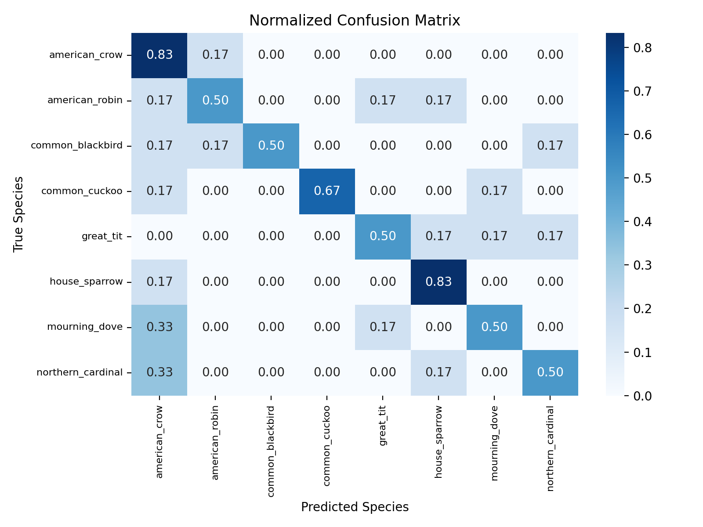
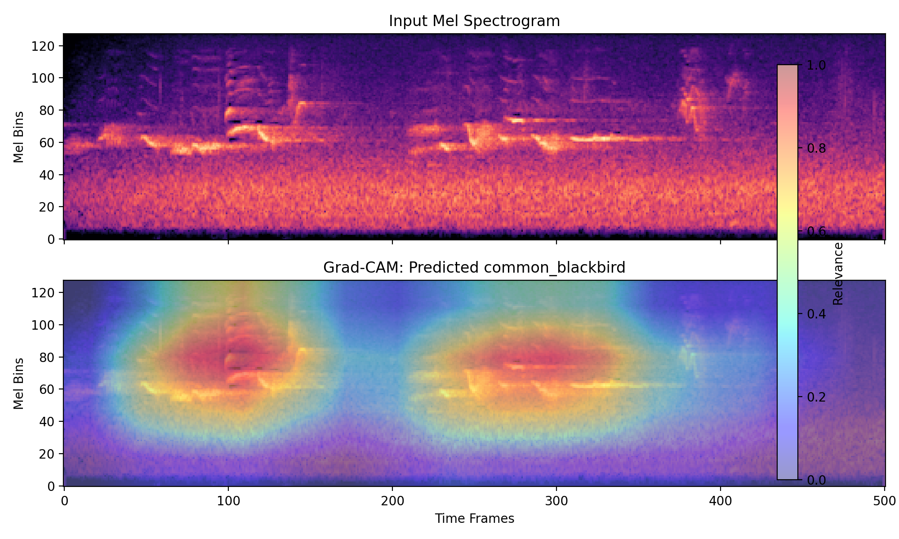

# Bird Species Audio Classification (Bioacoustics AI)

An end-to-end, leakage-free PyTorch & BirdNET bioacoustics system for identifying bird species from audio recordings (`5s` Log-Mel spectrograms, **EfficientNet-B0**, **CRNN**, **AST Transformer**, **Multi-Model Ensemble**, and **BirdNET v2.4 covering 6,522 species**), complete with **Grad-CAM visual explanations**, **iNaturalist Indian Bird dataset tooling**, a **Google Colab GPU pipeline**, and a **2-Tab Gradio Web App**.

---

## ✨ Key Capabilities

1. **Dual Classification Engine (Custom PyTorch + 6,522-Species BirdNET v2.4)**:
   - Run your own trained PyTorch classifiers (**EfficientNet-B0**, **ResNet-34 + BiGRU + Attention CRNN**, **AST Transformer**, or their **Probability Ensemble**).
   - Switch instantly in the UI dropdown to **BirdNET v2.4 (`ai-edge-litert`)** to identify **6,522 global & Indian bird species** directly on CPU with zero extra training required.
2. **Real Indian Birds Datasets + Auto Top-N Scraper (`iNaturalist` API)**:
   - Built-in curated **`indian16`** preset (16 iconic Indian & common birds) and **`core8`** preset.
   - Dynamic **`--auto_india_top N`** flag automatically resolves the top `N` (e.g. `50`, `100`, up to `516` available) most-recorded Indian bird species with research-grade audio from iNaturalist (`place_id=6681`).
3. **Zero-Leakage Pipeline & Robust Audio Inference**:
   - Stratified filename splits (`70/15/15`) or recordist-disjoint author splits (`src/data/splits.py`), assigning anonymous/`Unknown` authors unique IDs.
   - Energy-ranked chunk caching strictly for the `train` split (`cache_energy_chunks` + aligned `WeightedRandomSampler`), `150 Hz` acoustic high-pass Mel cutoff (`audio.fmin=150.0`), and `soxr_hq` resampling across arbitrary phone/microphone sample rates.
   - Confidence- & RMS-energy-weighted sliding window pooling (`src/utils/audio_inference.py`) with adjustable unknown-species gating slider.
4. **Teacher-Ready 2-Tab Interactive Web UI (`app/app.py`)**:
   - **Tab 1 — Live Bird Classifier:** Upload or record `.ogg`/`.wav`/`.flac`/`.mp3`, switch between custom checkpoints / Ensemble / BirdNET v2.4, inspect **Grad-CAM visual attribution**, **5s Log-Mel Spectrogram**, and **Per-Window Confidence Timeline**.
   - **Tab 2 — Evaluation & Benchmarks:** Dynamically reads `runs/*/evaluation_test/` to present cross-run comparison metrics, normalized confusion matrix, sample test Grad-CAM map, and per-species Precision / Recall / F1 / AP reports.
5. **Free Cloud GPU Training (`notebooks/colab_train_birdclef.ipynb`)**:
   - One-click Google Colab (`T4` / `L4` / `A100`) notebook that prepares data, trains **EfficientNet-B0 + CRNN + AST**, evaluates their **Ensemble**, and exports a `.zip` bundle ready for your local Gradio app.

---

## 📂 Repository Structure

```text
bird-audio-classification/
├── app/
│   ├── app.py                              # 2-Tab Gradio Web App (Classifier + Benchmarks + BirdNET v2.4)
│   └── examples/                           # Sample audio clips
├── configs/
│   ├── base.yaml                           # Master configuration (audio, splits, augmentations)
│   ├── indian_birds.yaml                   # 16 Indian birds training config (fmin=150Hz)
│   ├── effnet_b0.yaml                      # Pretrained EfficientNet-B0 (timm)
│   ├── effnet_b0_real.yaml                 # Local CPU real-audio config
│   ├── baseline_cnn.yaml                   # 4-block ConvNet baseline
│   ├── crnn.yaml                           # ResNet-34 + BiGRU + Attention Pooling
│   ├── ast.yaml                            # Audio Spectrogram Transformer (MIT AudioSet)
│   └── ablations.yaml                      # Automated ablation matrix specs
├── data/
│   ├── metadata/                           # Debug/smoke split metadata
│   ├── metadata_real/                      # Core 8 iNaturalist metadata & splits
│   └── noise/                              # Background noise bank (.npy ignored in git)
├── notebooks/
│   ├── 01_eda.py                           # Exploratory audio analysis script
│   └── colab_train_birdclef.ipynb          # Google Colab Multi-Model GPU Pipeline (indian16 / auto_india_top / core8 / kaggle)
├── reports/
│   ├── BirdCLEF_2025_Technical_Report.pdf  # Compiled project technical report
│   ├── Colab_GPU_Experiment_Report.md      # Full Colab GPU experiment write-up
│   ├── colab_figures/                      # Exported confusion matrix, Grad-CAM, training curves
│   ├── domain_shift/                       # Soundscape timeline visualizations
│   └── pdf_build/                          # LaTeX sources and generated figures
├── scripts/
│   ├── download_inat_birds.py              # iNaturalist downloader (--preset indian16/core8, --auto_india_top N)
│   ├── prepare_data.py                     # Ingestion, zero-leakage splits, noise bank, train chunk cache
│   ├── train.py                            # Mixed-precision training loop with checkpointing
│   ├── evaluate.py                         # Sliding-window test evaluation + confusion matrix + Grad-CAM
│   ├── infer.py                            # CLI audio file/folder inference with ensemble support
│   ├── run_seeds.py                        # Multi-seed reproducibility benchmark
│   ├── run_ablations.py                    # Systematic ablation driver
│   └── domain_shift_demo.py                # Long soundscape species timeline detector
├── src/
│   ├── data/                               # Audio loader (soxr_hq), splits, augmentations, PyTorch Dataset
│   ├── features/                           # On-GPU Log-Mel, MFCC, STFT, PCEN frontends
│   ├── models/                             # BaselineCNN, timm CNN, CRNN, AST, PANNs, Wav2Vec2, Ensemble
│   ├── training/                           # Losses, schedulers, balanced sampler, Trainer
│   ├── evaluation/                         # Macro-F1, ROC-AUC, cmAP, error audit, Grad-CAM
│   └── utils/                              # Config loader, sliding-window pooling, I/O, logging, seeds
├── tests/                                  # Pytest unit & regression test suite (26 tests)
├── Makefile                                # Automation shortcuts (.venv-aware)
├── requirements.txt                        # Python dependencies (PyTorch, timm, transformers, gradio, birdnet)
└── README.md
```

---

## ⚡ Quickstart Setup (Works on Any Laptop — CPU or GPU)

> **Important:** The repository intentionally excludes `.venv/`, downloaded `.ogg` audio datasets (`data/`), and large checkpoint weights (`runs/`). You create `.venv` once locally. Once dependencies are installed, **`app/app.py` runs immediately using BirdNET v2.4 (6,522 species) even before you train any custom model.**

### 1. Clone & Create Virtual Environment
**Linux / macOS:**
```bash
git clone https://github.com/Haricharanv/bird-audio-classification.git
cd bird-audio-classification

# System audio codecs (Ubuntu / Debian)
sudo apt-get update && sudo apt-get install -y ffmpeg libsndfile1

python3 -m venv .venv
source .venv/bin/activate
python -m pip install --upgrade pip
pip install -r requirements.txt
```

**Windows (PowerShell):** *(make sure [FFmpeg](https://ffmpeg.org/) is installed on PATH)*
```powershell
git clone https://github.com/Haricharanv/bird-audio-classification.git
cd bird-audio-classification

python -m venv .venv
.\.venv\Scripts\Activate.ps1
python -m pip install --upgrade pip
pip install -r requirements.txt
```

### 2. Verify Tests
```bash
pytest tests/ -v
```

### 3. Launch the Interactive Web App Immediately
```bash
python app/app.py
```
Open **`http://localhost:7860`** in your browser.
* Select **`BirdNET v2.4 (6,500+ Global & Indian Species)`** to classify any bird call right away without training.
* If you have trained checkpoints inside `runs/<run_name>/best_model.pt`, they load automatically alongside the **Ensemble** switcher and **Evaluation & Benchmarks** tab.

---

## 🇮🇳 Training on Indian Birds (Local or Free Google Colab GPU)

### Option A: Train Locally (Quick 16-Species Indian Birds Preset)
```bash
# 1. Download 16 iconic Indian bird species (20 clips each) from iNaturalist
python scripts/download_inat_birds.py --out_dir ../data/indian_birds --preset indian16 --per_species 20 --workers 8

# OR auto-fetch the top 50 / 100 most-recorded Indian birds dynamically:
# python scripts/download_inat_birds.py --out_dir ../data/india_top_50 --auto_india_top 50 --per_species 30 --workers 8

# 2. Prepare zero-leakage splits, noise bank, and train-only chunk cache
python scripts/prepare_data.py --config configs/indian_birds.yaml debug=false

# 3. Train EfficientNet-B0
python scripts/train.py --config configs/indian_birds.yaml

# 4. Copy species taxonomy into run folder and run held-out test evaluation
RUN_DIR=$(ls -td runs/*effnet_b0_indian16* | head -n 1)
cp ../data/indian_birds/taxonomy.csv "$RUN_DIR/taxonomy.csv"
python scripts/evaluate.py --checkpoint "$RUN_DIR/best_model.pt" --config configs/indian_birds.yaml --split test
```

*(Note on HuggingFace / offline environments: [src/models/ast_wrapper.py](src/models/ast_wrapper.py) skips downloading pretrained weights cleanly whenever `model.pretrained=false` is set.)*

### Option B: Free Google Colab GPU Pipeline (`T4` / `L4` / `A100`) — **No Local GPU Needed**
1. Open [notebooks/colab_train_birdclef.ipynb](notebooks/colab_train_birdclef.ipynb) in Google Colab and switch runtime to **T4 GPU**.
2. Set `DATASET_MODE`:
   - `"indian16"` — 16 iconic Indian & common birds
   - `"auto_india_top"` with `AUTO_INDIA_TOP_N = 50` (or `100`) — top Indian species with research-grade iNaturalist audio
   - `"core8"` — 8-species fast benchmark
   - `"kaggle"` — full 206-species Kaggle BirdCLEF+ 2025 competition dataset (`kaggle.json` upload)
3. Click **Run All** to train **EfficientNet-B0**, **CRNN**, and **AST**, evaluate their **Ensemble**, and download the exported `.zip` bundle.
4. Extract that `.zip` into `bird-audio-classification/` locally and run `python app/app.py` to explore all models & benchmarks in your browser.

---

## 🗂️ Datasets & Observed Results

### Datasets Integrated in This Project

| Dataset / Source | Species | Recordings / Scope | Use Case |
| :--- | :---: | :--- | :--- |
| **Indian 16 Preset (`indian16`)** | `16` iconic Indian species | `240` iNaturalist research-grade `32 kHz` OGG clips (`15`/species: `168` train / `36` val / `36` test) | Local Indian bird classifier (`indian_birds.yaml`) |
| **Auto India Top-N (`--auto_india_top`)** | User-selected (`50`, `100`, up to `516`) | Dynamically fetched from iNaturalist India (`place_id=6681`, `taxon_id=3`, `sounds=true`) | Scaled Colab GPU custom training |
| **Core 8 Global Birds (`core8`)** | `8` common global species | `160` local clips (`20`/species) & `320` Colab GPU clips (`40`/species) from iNaturalist | Cross-architecture benchmarking & ablations |
| **Pretrained BirdNET v2.4 (`litert`)** | `6,522` global & Indian species | Cornell Lab of Ornithology Acoustic Model v2.4 (`ai-edge-litert`) | Zero-training general bird inference in `app/app.py` |
| **Debug Smoke Dataset (`debug=true`)** | `5` synthetic/debug classes | `60` clips (`42` train / `9` val / `9` test) | Rapid CPU pipeline verification |
| **Kaggle BirdCLEF+ 2025 (`kaggle` mode)** | `206` species | Supported in `colab_train_birdclef.ipynb` & `configs/base.yaml` (requires `kaggle.json`) | Full competition-scale training |

**`indian16` Species List:** Indian Peafowl (*Pavo cristatus*), Asian Koel (*Eudynamys scolopaceus*), House Crow (*Corvus splendens*), Common Myna (*Acridotheres tristis*), Rose-ringed Parakeet (*Psittacula krameri*), House Sparrow (*Passer domesticus*), Rock Pigeon (*Columba livia*), Spotted Dove (*Spilopelia chinensis*), Coppersmith Barbet (*Psilopogon haemacephalus*), Red-vented Bulbul (*Pycnonotus cafer*), White-throated Kingfisher (*Halcyon smyrnensis*), Oriental Magpie-Robin (*Copsychus saularis*), Common Tailorbird (*Orthotomus sutorius*), Black Kite (*Milvus migrans*), Greater Coucal (*Centropus sinensis*), Common Cuckoo (*Cuculus canorus*).

### Verified Held-Out Test Results

| Run / Dataset | Hardware | Train / Val / Test Files | Macro-F1 | Weighted-F1 | Top-1 Acc | Top-3 Acc | ROC-AUC | Report |
| :--- | :--- | :---: | :---: | :---: | :---: | :---: | :---: | :--- |
| **`core8` (20/species)** | Local CPU (`effnet_b0`) | 112 / 24 / 24 | 0.5020 | 0.5020 | 50.00% | 75.00% | 0.8294 | [Experiment Report](reports/Colab_GPU_Experiment_Report.md) |
| **`core8` (40/species)** | Colab GPU (`effnet_b0`) | 224 / 48 / 48 | **0.6111** | **0.6111** | **60.42%** | **83.33%** | **0.8988** | [Experiment Report](reports/Colab_GPU_Experiment_Report.md) |
| **`indian16` (15/species)** | Local CPU (10 ep, `effnet_b0`) | 168 / 36 / 36 | 0.3661 | 0.3890 | 44.44% | 55.56% | 0.8153 | `runs/20261126_224757_effnet_b0_indian16/evaluation_test/` |

<p align="center">
  
  
</p>

---

## 🛠️ Additional CLI Tools

```bash
# Standalone inference on a file or directory (supports single checkpoint or directory ensemble)
python scripts/infer.py --checkpoint runs/<run_name>/best_model.pt --audio_path path/to/recording.ogg --top_k 5

# Multi-seed variance check
python scripts/run_seeds.py --config configs/effnet_b0.yaml --seeds 42 43 44

# Automated ablation study (frontends, losses, augmentations, chunk lengths)
python scripts/run_ablations.py --config configs/ablations.yaml

# Long soundscape temporal detection demo
python scripts/domain_shift_demo.py --checkpoint runs/<run_name>/best_model.pt
```
