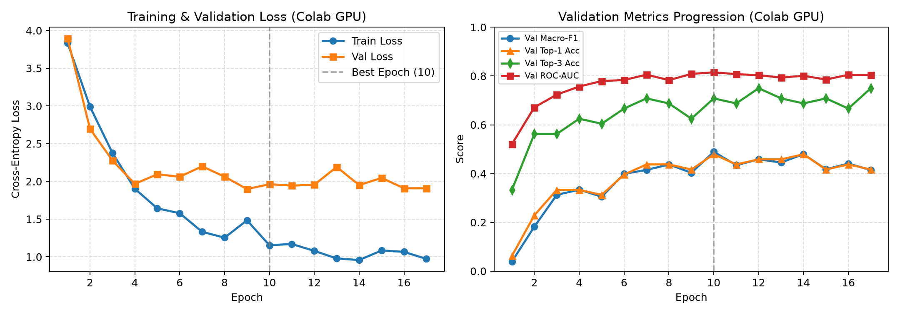
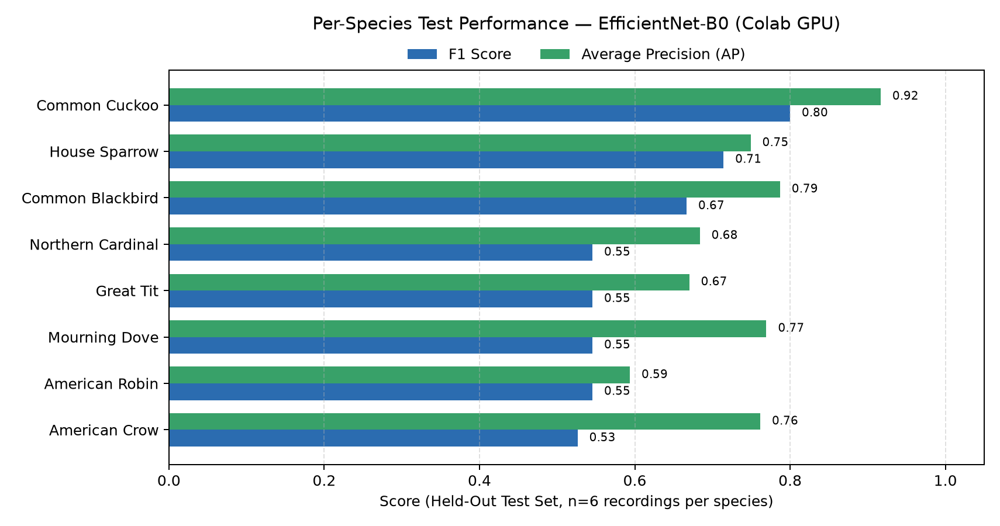
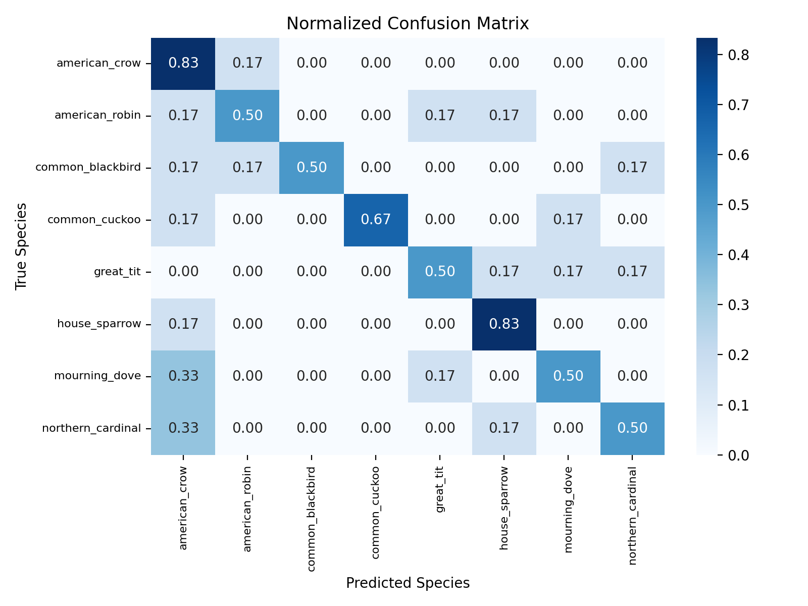
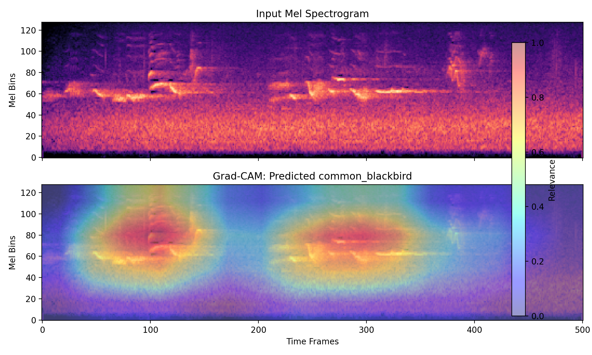
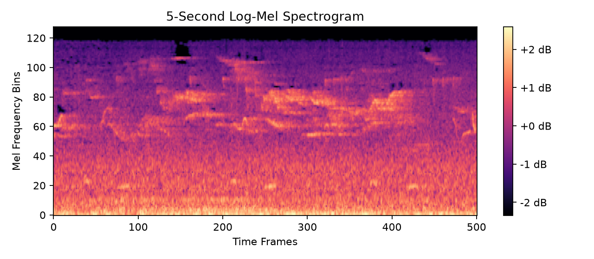
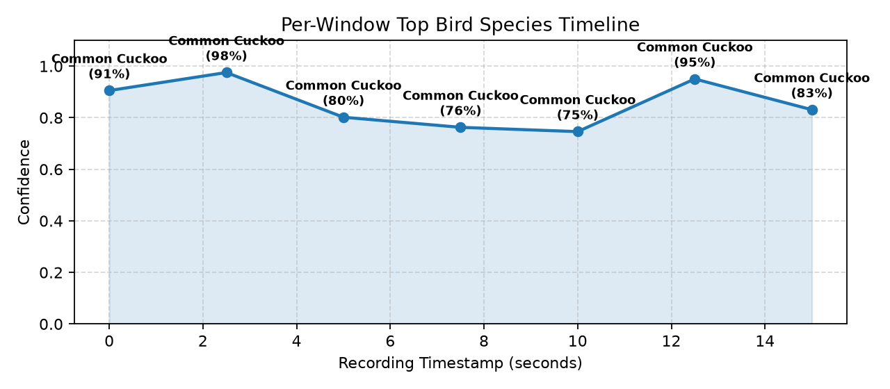

# Bird Species Audio Classification — Colab GPU Experiment Documentation

## 1. Experiment Configuration & Pipeline Summary

| Setting | Value |
| :--- | :--- |
| **Run ID** | `20261125_075115_effnet_b0` |
| **Notebook** | [colab_train_birdclef.ipynb](../notebooks/colab_train_birdclef.ipynb) |
| **Architecture** | `timm_cnn` (`efficientnet_b0`, ImageNet-pretrained, 1-channel input, `dropout=0.3`) |
| **Audio Frontend** | On-GPU Log-Mel Spectrogram (`sr=32000`, `n_fft=1024`, `hop_length=320`, `n_mels=128`, `float32`) |
| **Dataset Source** | iNaturalist Research-Grade Audio (`40` recordings x `8` bird species = `320` recordings) |
| **Splits (70/15/15)** | **224** Train / **48** Validation / **48** Held-Out Test (6 test files per species) |
| **Compute & Training** | Google Colab `cuda` GPU (`batch_size=32`, `AdamW`, `OneCycleLR`, `label_smoothing=0.05`) |
| **Epochs Run** | `17` (Early stopping triggered after patience `7`; best checkpoint at **Epoch 10**) |

---

## 2. Training & Validation Progression

| Epoch | Train Loss | Val Loss | Val Macro-F1 | Val Top-1 Acc | Val Top-3 Acc | Val ROC-AUC | Time (s) |
| :---: | :---: | :---: | :---: | :---: | :---: | :---: | :---: |
| 1 | 3.8366 | 3.8962 | 0.0396 | 6.25% | 33.33% | 0.5208 | 38.67 |
| 4 | 1.9019 | 1.9674 | 0.3341 | 33.33% | 62.50% | 0.7569 | 34.32 |
| 7 | 1.3316 | 2.1994 | 0.4151 | 43.75% | 70.83% | 0.8056 | 31.17 |
| **10 (Best)** | **1.1540** | **1.9629** | **0.4893** | **47.92%** | **70.83%** | **0.8155** | **31.38** |
| 14 | 0.9577 | 1.9506 | 0.4796 | 47.92% | 68.75% | 0.8011 | 31.23 |
| 17 (Stop) | 0.9725 | 1.9098 | 0.4143 | 41.67% | 75.00% | 0.8046 | 34.42 |

---

## 3. Held-Out Test Set Evaluation (48 Unseen Recordings)

| Metric | Local CPU Run (20/species) | **Colab GPU Run (40/species)** |
| :--- | :---: | :---: |
| **Macro-F1** | 0.5020 | **0.6111** |
| **Weighted-F1** | 0.5020 | **0.6111** |
| **Top-1 Accuracy** | 50.00% | **60.42%** (random: 12.50%) |
| **Top-3 Accuracy** | 75.00% | **83.33%** |
| **Macro ROC-AUC** | 0.8294 | **0.8988** |

### Per-Species Breakdown

| Species | Scientific Name | Precision | Recall | F1 Score | Average Precision | Support |
| :--- | :--- | :---: | :---: | :---: | :---: | :---: |
| Common Cuckoo | *Cuculus canorus* | 1.000 | 0.667 | **0.800** | **0.917** | 6 |
| House Sparrow | *Passer domesticus* | 0.625 | 0.833 | **0.714** | 0.749 | 6 |
| Common Blackbird | *Turdus merula* | 1.000 | 0.500 | **0.667** | 0.787 | 6 |
| Mourning Dove | *Zenaida macroura* | 0.600 | 0.500 | 0.545 | 0.769 | 6 |
| Northern Cardinal | *Cardinalis cardinalis* | 0.600 | 0.500 | 0.545 | 0.684 | 6 |
| Great Tit | *Parus major* | 0.600 | 0.500 | 0.545 | 0.670 | 6 |
| American Robin | *Turdus migratorius* | 0.600 | 0.500 | 0.545 | 0.594 | 6 |
| American Crow | *Corvus brachyrhynchos* | 0.385 | 0.833 | 0.526 | 0.762 | 6 |

---

## 4. Confusion Matrix & Grad-CAM Attribution

---

## 5. Local Gradio Inference Output (Colab Checkpoint)

Test recording: `common_cuckoo_test.ogg`
- **Common Cuckoo (*Cuculus canorus*)**: **85.3%**
- American Robin (*Turdus migratorius*): 6.8%
- Mourning Dove (*Zenaida macroura*): 3.0%

